# ECHO

**A local-first, voice-capable AI desktop assistant for Linux.**
Tasks, notes, documents, email, calendar and contacts in one app that runs on your own computer, with an assistant that shows, asks before and can undo every action it takes.

[**Read the full case study →**](https://yurihtal.github.io/echo/) &nbsp;·&nbsp; [Portfolio](https://yurihtal.github.io/) &nbsp;·&nbsp; [Book a live demo](https://calendly.com/yurihlebanja/quickchat)

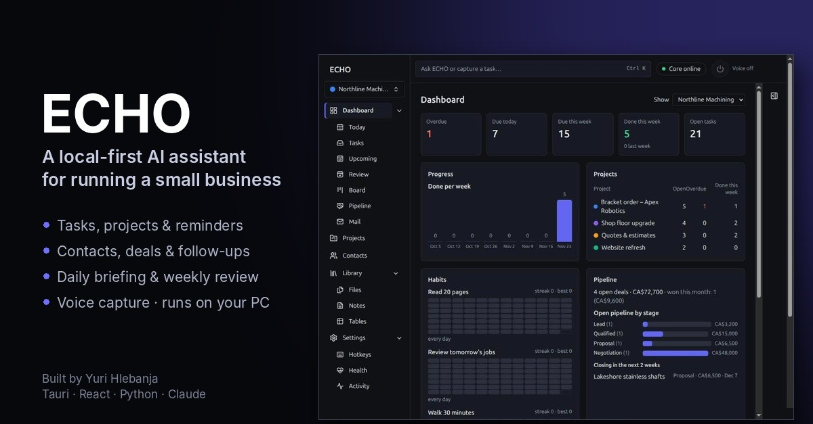

> The source code is private. This repository shows what ECHO looks like and how it is built.
> All screenshots use sample data for a fictional machine shop.

---

## What it does

| | |
|---|---|
| **Capture & voice** | "Hey Jarvis" wake word, push-to-talk, quick capture (Ctrl+K), dictation in any text box, brain dump → tasks |
| **Tasks & habits** | Projects and workspaces, board view, repeating tasks, habit streaks, reminders, undo for every change |
| **Knowledge** | Markdown notes, search across PDF and Office files, answers that cite their sources, search everything (Ctrl+P) |
| **Connections** | Gmail, Google Calendar, Google Drive, Notion and any MCP server; Telegram chat and voice notes; sending always asks first |
| **People & CRM** | People and companies, timelines, follow-up reminders, deal pipeline |
| **Planning** | Daily briefing (read aloud on request), dashboard, weekly review |
| **Documents & tables** | New Word, Excel, PowerPoint and PDF files; grid tables with Excel / CSV export |

## Screens

| Today | Dashboard |
|---|---|
| 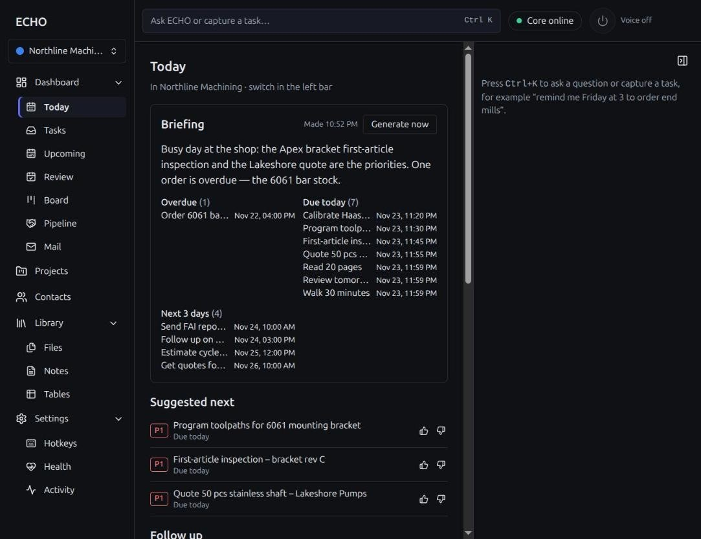 | 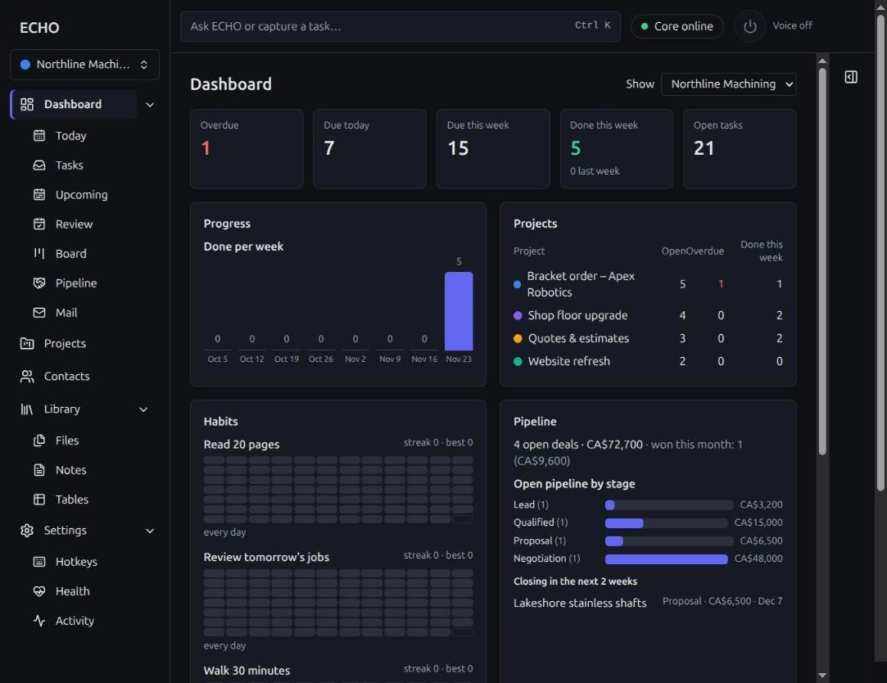 |
| **Board** | **Upcoming** |
| 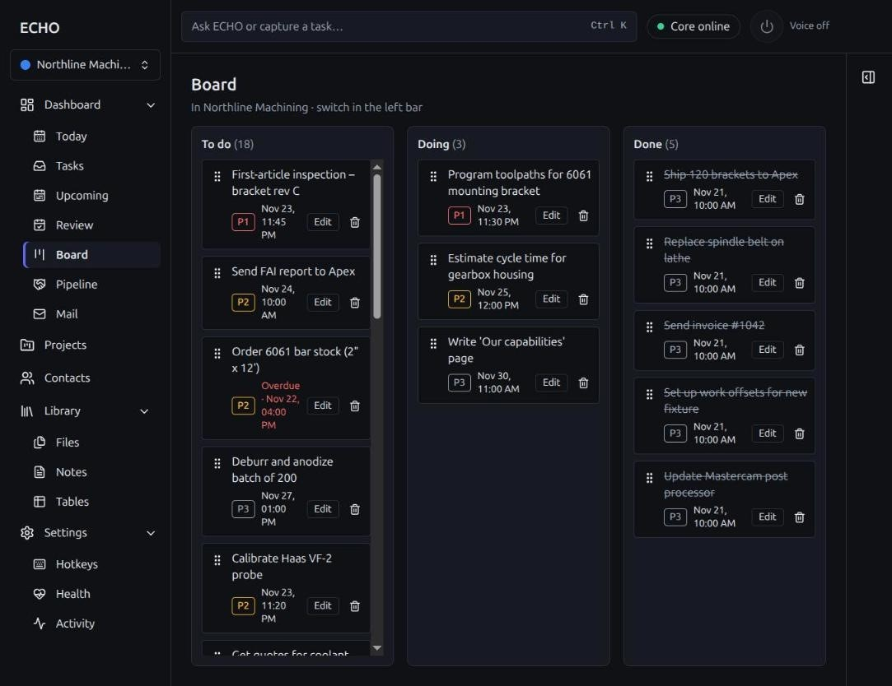 | 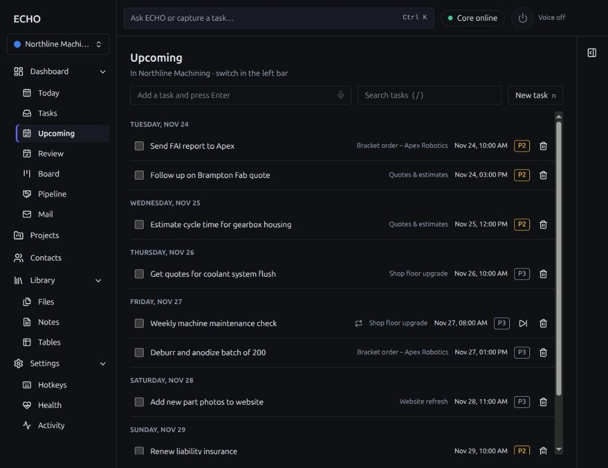 |
| **Pipeline** | **Contacts** |
| 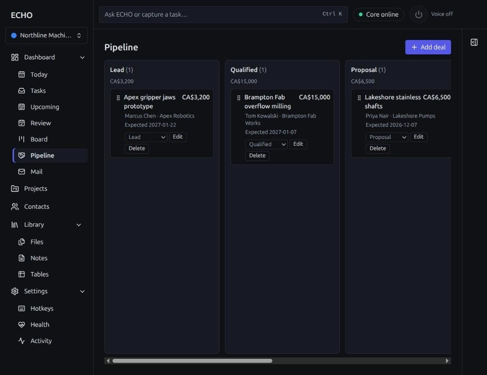 | 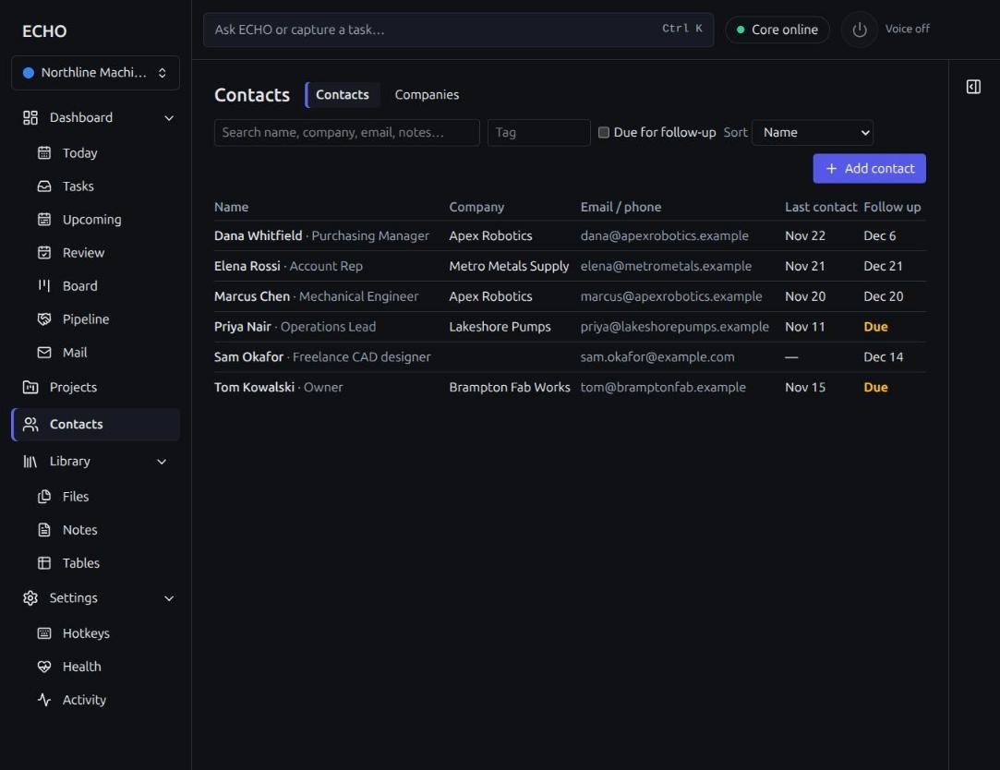 |
| **Contact timeline** | **Notes** |
| 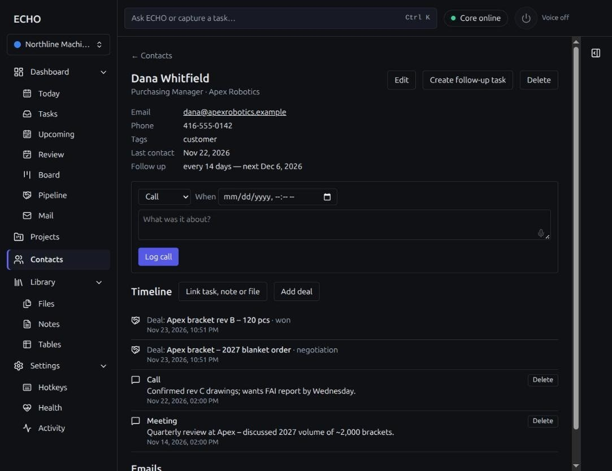 | 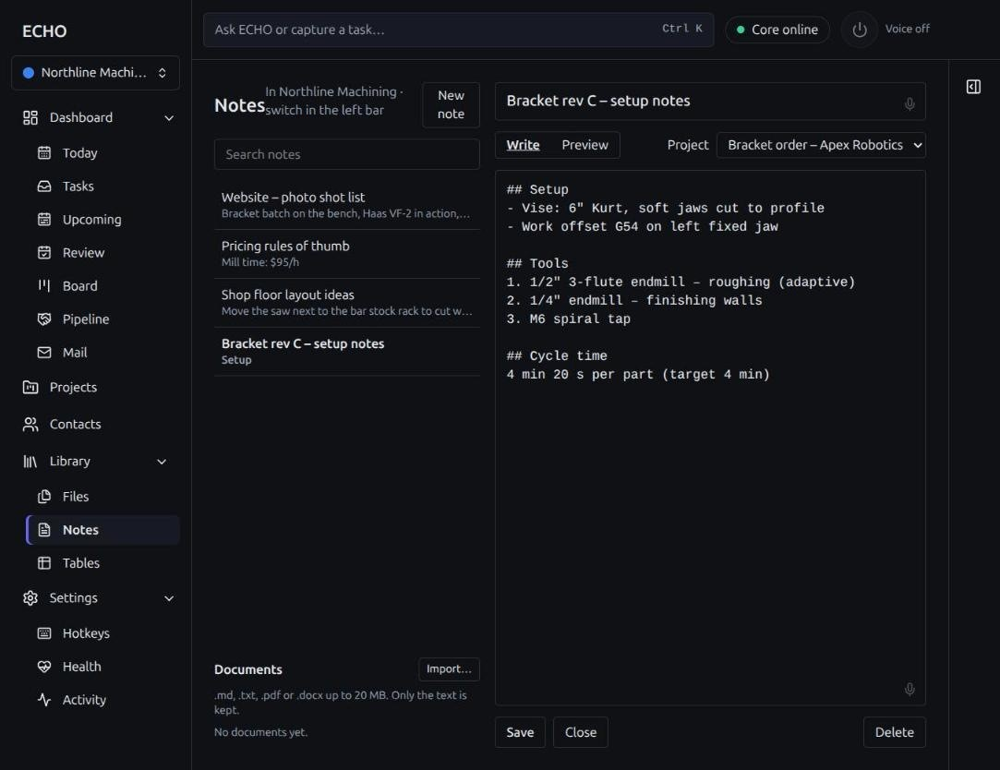 |
| **Tables** | **Mail** |
| 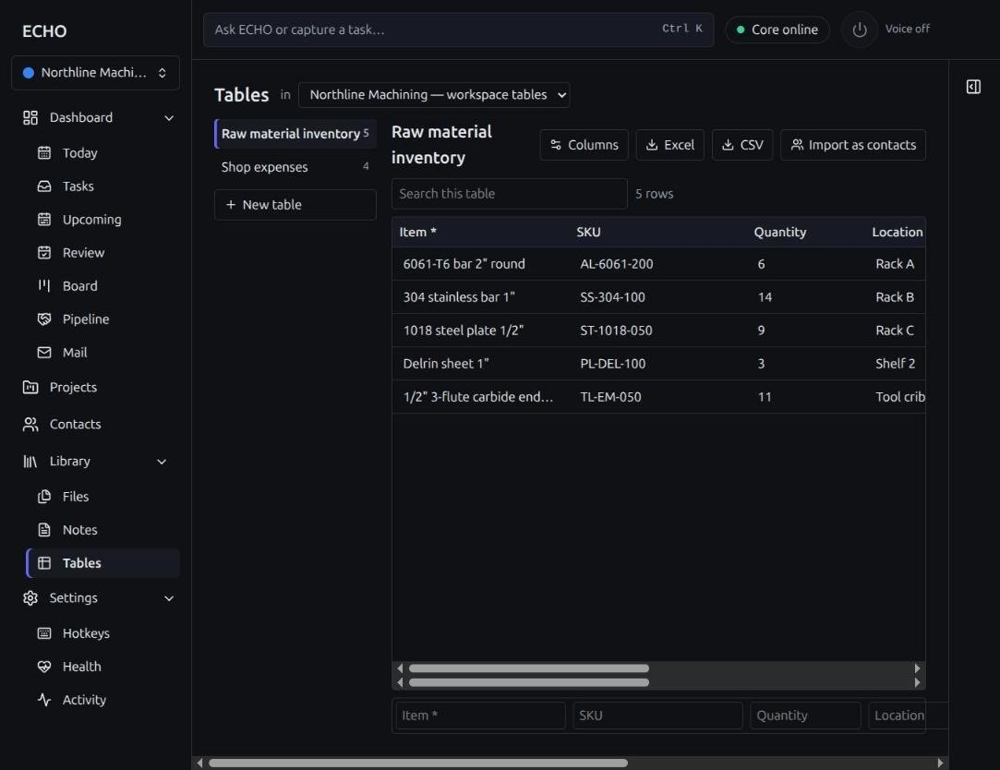 | 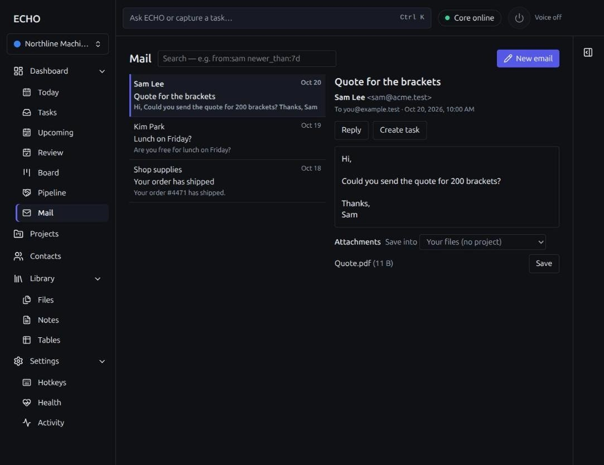 |
| **Activity (audit trail)** | **Settings** |
| 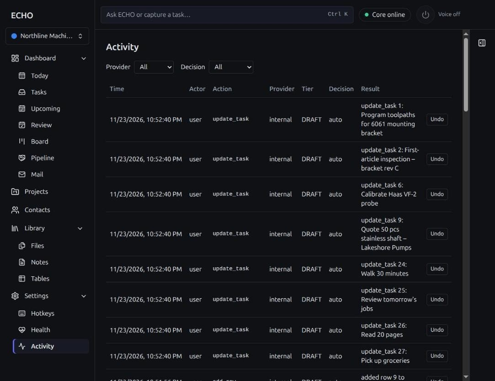 | 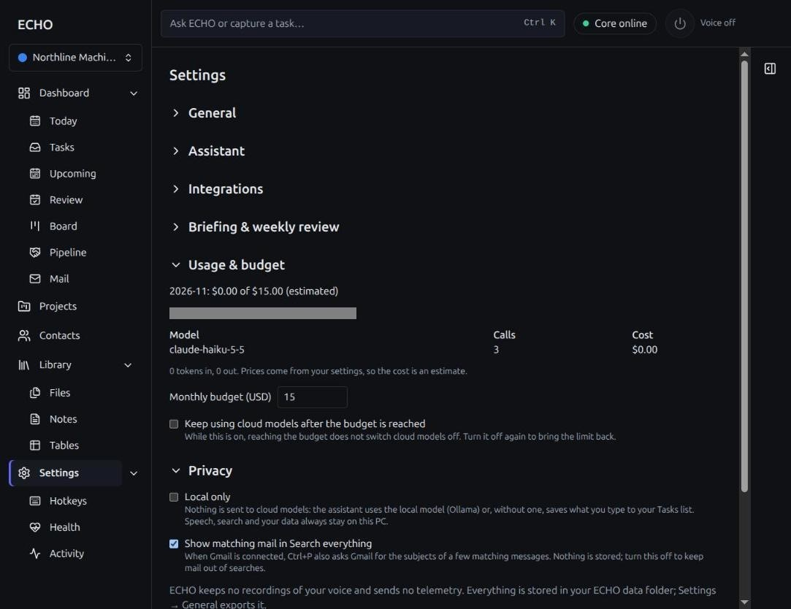 |

## How it is built

```
Desktop window   Tauri 2 (Rust) · React · TypeScript · TanStack Query · Zustand
      │  REST + WebSocket · per-launch token · 127.0.0.1 only
Python core      Python 3.12 · FastAPI · SQLAlchemy · Alembic · SQLite FTS5
      ├─ Model router    Claude → Groq → local Ollama, with a monthly budget cap
      ├─ Speech          openWakeWord · faster-whisper · Kokoro (all on device)
      ├─ Connections     MCP: Notion · Calendar · Gmail · Drive
      └─ Guardrails      Read / Confirm / Execute tiers · approval cards · undo
Packaging        PyInstaller + Tauri bundle → .deb and AppImage for Ubuntu
```

- **Your data stays on your machine.** The cloud is used only for the language model, and only when needed. With "local only" on, nothing leaves the PC.
- **Safe by design.** Email, notes and web text are treated as untrusted, so a prompt-injection attempt can't make the assistant act without your approval. Keys live only in the system keyring, and every tool call is logged with one-click undo.
- **Built like a production system.** Specification and threat model first, then 28+ gated milestones, 35+ architecture decision records and 1,900+ automated tests.

## About

Built by **Yuri Hlebanja**: CNC programmer and CAD/CAM designer building AI software for manufacturing and small business.

- Portfolio: [yurihtal.github.io](https://yurihtal.github.io/)
- ECHO case study: [yurihtal.github.io/echo](https://yurihtal.github.io/echo/)
- Book a live demo: [calendly.com/yurihlebanja/quickchat](https://calendly.com/yurihlebanja/quickchat)
